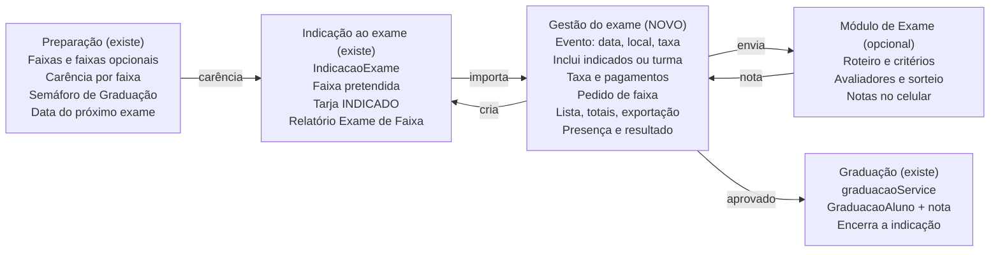

# Especificação — Módulo de Gestão de Exames de Faixa

24/11/2026 · Fulvio Vilas Boas

## Visão geral

O módulo de Gestão do Exame é a camada que falta entre a **Indicação** e a **Graduação**. Hoje a indicação diz *quem* vai prestar, e o Módulo de Exame diz *como* cada um foi avaliado. Ninguém controla taxa, pagamento, compra de faixa e a lista do dia, e é isso que este módulo faz.

Ele não cria um cadastro novo de exame. Reaproveita a tabela `Exame` como o evento e `ExameParticipante` como o candidato. Assim, os blocos 2 e 3, que hoje não conversam, passam a se ligar pelo mesmo registro.

**Dentro do escopo**

- Dados de gestão do evento: local, taxa, preço da faixa, prazos
- Lista de candidatos montada a partir das indicações, de uma turma ou avulso
- Taxa do exame: valor, desconto, isenção e pagamentos parciais
- Pedido de faixa: quem quer comprar, tamanho, valor, pagamento e entrega
- Listagem completa com carência, filtros, totais e exportação
- Presença e resultado, com uma única forma de graduar o aluno

**Fora do escopo**

- Roteiro, avaliadores, sorteio e notas: continuam no Módulo de Exame, que segue opcional
- Correção das falhas internas do Módulo de Exame (nota da ficha, Branca/Cinza no roteiro, PIN)
- Pagamento online integrado e estoque de faixas

## Onde o módulo se encaixa

A gestão importa os indicados (ou cria a indicação quando o aluno entra por turma), envia os candidatos ao Módulo de Exame quando há avaliação e é o único ponto que manda o aprovado para a graduação.

## Conceitos e entidades

Duas entidades são novas: Pagamento e Pedido de Faixa. O resto já existe e ganha campos ou regras.

| Entidade | Situação | Papel no módulo |
| --- | --- | --- |
| `Exame` | Existe, ganha campos | É o **evento**: data, arte, local, taxa, preço da faixa, prazos. Um exame pode ser só de gestão, sem usar roteiro e avaliadores |
| `ExameParticipante` | Existe, ganha campos | É o **candidato**: liga aluno, indicação e exame. Guarda taxa, situação da inscrição, presença e resultado |
| `IndicacaoExame` | Existe, sem mudança de estrutura | Fonte dos candidatos e da faixa pretendida (inclusive a faixa opcional escolhida). Passa a ser encerrada pela gestão |
| `CriterioGraduacao` | Existe | Carência exibida na lista: aulas na faixa × mínimo |
| `GraduacaoAluno` + `graduacaoService` | Existe | Único caminho para graduar o aluno aprovado |
| `ExamePagamento` | **Nova** | Cada valor recebido de um candidato, da taxa ou da faixa |
| `ExamePedidoFaixa` | **Nova** | Compra de faixa pelo candidato: quer comprar, cor, tamanho, valor, entrega |

A situação da inscrição e a do pagamento ficam **separadas**. Um aluno pode estar confirmado e com pagamento parcial ao mesmo tempo.

## Fluxo de um exame

Oito passos, do evento à entrega das faixas. Os passos 2 e 8 são os que hoje estão desconectados.

1. **Criar o exame** em Exames, informando também local, taxa, preço da faixa e prazos. Marcar se vai usar avaliação (roteiro e avaliadores) ou só gestão.
2. **Montar a lista de candidatos**, por três caminhos combináveis:
   - *Importar indicados:* traz de uma vez as indicações abertas daquela arte, com a faixa pretendida já escolhida. Hoje seriam os 28 do Karatê.
   - *Indicar por turma:* escolher uma turma e marcar alunos. Para quem ainda não tem indicação, o sistema cria a `IndicacaoExame`, com a mesma regra de faixa opcional da tela do aluno.
   - *Avulso:* buscar um aluno e incluir, também criando a indicação.
3. **Conferir a carência** na própria lista e confirmar quem vai prestar.
4. **Registrar pagamentos da taxa**, inclusive parciais.
5. **Registrar o pedido de faixa** de cada candidato.
6. **Fechar as inscrições.** Gerar a lista final e o pedido consolidado de faixas.
7. **Dia do exame.** Lista de chamada e presença. Se o exame usa avaliação, o sorteio já encontra os candidatos presentes, sem cadastro manual.
8. **Resultado.** Marcar aprovado ou não na gestão. Aprovado chama o `graduacaoService` uma única vez: cria a graduação (com a nota, se houver), encerra a indicação e atualiza as matrículas. Depois, marcar a entrega das faixas.

## Requisitos funcionais

Dezoito requisitos. A coluna "Base" mostra o que já existe e é reaproveitado.

| ID | Requisito | Base existente | Fase |
| --- | --- | --- | --- |
| RF-01 | Incluir no cadastro do exame: local, horário, taxa padrão, preço padrão da faixa, prazo de pagamento, prazo do pedido de faixa e "usa avaliação" (sim/não) | `Exame` | 1 |
| RF-02 | Esconder roteiro, avaliadores e sorteio quando "usa avaliação" = não | `ExameDetalhe` | 1 |
| RF-03 | Importar indicações abertas da arte do exame, em lote, com a faixa pretendida da indicação, sem duplicar | `IndicacaoExame` | 1 |
| RF-04 | Indicar por turma: listar alunos da turma com faixa atual, carência e se já estão indicados; criar indicação + candidato para os marcados | regra de "Indicar p/ exame" | 1 |
| RF-05 | Incluir candidato avulso por busca de nome, criando a indicação | regra de "Indicar p/ exame" | 1 |
| RF-06 | Mostrar carência por candidato: aulas na faixa, mínimo exigido, "sem critério" quando não houver | `CriterioGraduacao`, relatório Exame de Faixa | 1 |
| RF-07 | Taxa por candidato: herda a do exame, aceita desconto ou isenção com motivo | — | 1 |
| RF-08 | Registrar pagamentos (data, valor, forma, referência taxa ou faixa), vários por candidato | — | 1 |
| RF-09 | Calcular situação do pagamento: Pendente, Parcial, Pago, Isento, Atrasado | — | 1 |
| RF-10 | Pedido de faixa: quer comprar (sim/não/sem resposta), cor (padrão: faixa pretendida), tamanho, valor, entregue | Faixas (cores) | 1 |
| RF-11 | Lista completa com busca e filtros (turma, faixa pretendida, inscrição, pagamento, pedido de faixa, carência) | — | 1 |
| RF-12 | Totais no topo: inscritos, confirmados, previsto, recebido, pendente, faixas pedidas | — | 1 |
| RF-13 | Exportar CSV/PDF, lista de chamada por faixa pretendida e pedido consolidado de faixas (cor × tamanho) | relatório Exame de Faixa | 1 |
| RF-14 | Desistência sem apagar o candidato; a indicação volta a ficar aberta e o candidato sai do sorteio | — | 1 |
| RF-15 | Presença e resultado gravados no candidato; aprovado chama o `graduacaoService` e encerra a indicação | `graduacaoService`, "✓ Aprovado" | 2 |
| RF-16 | "Confirmar graduação" do Módulo de Exame passa a usar o mesmo caminho do RF-15 | `examesController` | 2 |
| RF-17 | Texto de cobrança para WhatsApp, com valor pendente, para copiar | — | 2 |
| RF-18 | Histórico de alterações em pagamentos e resultado (quem e quando) | — | 2 |

## Telas

Nenhuma tela de topo nova: a gestão entra como abas no `ExameDetalhe`, e a lista de exames ganha colunas.

**Exames (alterada)**

- Novas colunas: local, nº de candidatos, % recebido
- No cadastro: os campos do RF-01

**ExameDetalhe (alterada) — abas novas**

- **Candidatos:** cabeçalho com os totais (RF-12) e a tabela com Aluno, Turma, Faixa atual → pretendida, Carência (ex.: 28/32), Taxa, Pago, Situação do pagamento, Faixa (tamanho ou "não"), Inscrição. Ações em massa: confirmar, marcar como pago, exportar
- **Faixas:** pedido consolidado por cor × tamanho e controle de entrega
- **Financeiro:** pendências, com responsável e telefone
- **Lista de chamada:** impressão e presença
- **Resultado:** aprovado ou não, por candidato; mostra a nota quando o exame usa avaliação
- As abas atuais (roteiro, avaliadores, sorteio, progresso) só aparecem se "usa avaliação" = sim

**Adicionar candidatos (nova janela)**

- Três abas: **Indicados** · **Por turma** · **Avulso**
- Em cada linha: faixa atual, faixa pretendida (da indicação, ou sugerida com a pergunta da faixa opcional) e carência
- Quem já é candidato aparece desabilitado

**Ficha do candidato (novo painel lateral)**

- Aluno, responsável e telefone; faixa atual e pretendida; taxa, desconto e motivo
- Pagamentos, com o botão "Registrar pagamento" já preenchido com o saldo
- Pedido de faixa e observações

**AlunoDetalhe (alterada)**

- A tarja INDICADO AO PRÓXIMO EXAME mostra também a situação do pagamento quando o aluno for candidato
- "✓ Aprovado" fica bloqueado se a indicação estiver em um exame aberto, com aviso para graduar pelo exame

Registrar pagamento precisa funcionar bem no celular, porque é no fim da aula que o aluno paga.

## Modelo de dados

Duas tabelas existentes ganham campos e duas tabelas novas entram. Nomes no padrão das tabelas atuais; ajustar tipos ao banco.

**Exame — campos novos**

| Campo | Tipo | Observação |
| --- | --- | --- |
| `usa_avaliacao` | booleano | Padrão: sim, para não mudar os exames atuais |
| `local`, `horario` | texto, time | |
| `taxa_padrao` | decimal | Herdada pelos candidatos |
| `preco_faixa_padrao` | decimal | Herdado pelos pedidos de faixa |
| `prazo_pagamento` | date | Define "Atrasado" |
| `prazo_pedido_faixa` | date | |
| `inscricoes_fechadas` | booleano | Bloqueia inclusão de candidatos; independe do ciclo Planejamento → Finalizado |

**ExameParticipante — campos novos**

| Campo | Tipo | Observação |
| --- | --- | --- |
| `indicacao_exame_id` | FK → IndicacaoExame | Obrigatório para novos candidatos; único por exame |
| `turma_id` | FK | Turma de origem, para filtro |
| `valor_taxa`, `desconto` | decimal | |
| `motivo_desconto` | texto | |
| `isento` | booleano | |
| `status_inscricao` | enum | indicado, confirmado, desistiu |
| `presenca` | enum, opcional | presente, ausente |
| `resultado` | enum, opcional | aprovado, nao_aprovado |
| `graduacao_aluno_id` | FK, opcional | Preenchido ao graduar; é o que impede graduar duas vezes |
| `observacoes` | texto | |

Faixa atual e pretendida já existem no participante; a pretendida passa a vir da indicação.

**ExamePagamento — nova**

| Campo | Tipo | Observação |
| --- | --- | --- |
| `id` | PK | |
| `exame_participante_id` | FK | |
| `referente` | enum | taxa, faixa |
| `data` | date | |
| `valor` | decimal | |
| `forma` | enum | pix, dinheiro, cartao, transferencia |
| `comprovante_url` | texto, opcional | |
| `observacao` | texto | |
| `registrado_por`, `criado_em` | FK, timestamp | Histórico (RF-18) |

**ExamePedidoFaixa — nova** (um por candidato)

| Campo | Tipo | Observação |
| --- | --- | --- |
| `id` | PK | |
| `exame_participante_id` | FK, único | |
| `quer_comprar` | enum | sim, nao, sem_resposta |
| `faixa_id` | FK → Faixas | Padrão: faixa pretendida |
| `tamanho` | texto | Numeração do fornecedor |
| `valor` | decimal | |
| `entregue`, `entregue_em` | booleano, date | |

Valor pago e situação do pagamento **não são gravados**: são calculados a partir de `ExamePagamento`.

**API**

- `/api/exames/:id/candidatos`: listar, importar indicados, incluir por turma ou avulso, atualizar
- `/api/exames/:id/pagamentos` e `/api/exames/:id/pedidos-faixa`
- `/api/exames/:id/resultado`: grava resultado e chama o `graduacaoService`
- `/api/relatorios/exame-faixa` ganha filtro por exame

## Regras de negócio

**Candidatos e indicação**

- RN-01: todo candidato tem uma `IndicacaoExame`. Incluir por turma ou avulso cria a indicação, com as regras atuais: próxima faixa, pergunta quando a próxima é opcional, aluno sem graduação vai para a primeira.
- RN-02: uma indicação fica em no máximo um exame aberto, e um aluno entra uma vez por exame (regra que já existe).
- RN-03: só entram indicações e alunos da arte do exame.
- RN-04: permissões iguais às da indicação: admin inclui qualquer aluno; professor, só alunos das turmas dele naquela arte.
- RN-05: carência é informativa: aluno abaixo do mínimo pode entrar, mas aparece destacado. Faixas sem critério (Marrom 3, Preta) mostram "sem critério".
- RN-06: com inscrições fechadas, ninguém entra sem reabrir.
- RN-07: desistência mantém o candidato e os pagamentos; a indicação volta a ficar livre para o próximo exame; o candidato não entra no sorteio.

**Pagamento**

- RN-08: devido = taxa − desconto; isento = devido zero.
- RN-09: situação:
  - Isento: isento marcado
  - Pendente: nada pago
  - Parcial: pago maior que zero e menor que o devido
  - Pago: pago igual ou maior que o devido
  - Atrasado: Pendente ou Parcial depois do prazo
- RN-10: pago acima do devido gera alerta de "crédito a devolver".
- RN-11: lançamento não é alterado nem apagado sem registro no histórico.
- RN-12: pedido de faixa com "sim" exige tamanho e valor; a situação de pagamento da faixa segue a RN-09, com os pagamentos "faixa".

**Resultado e graduação**

- RN-13: existe um só caminho para graduar: gravar "aprovado" no candidato chama o `graduacaoService` numa transação, que cria a `GraduacaoAluno` (com `nota_exame` e `exame_participante_id` quando houver), encerra a indicação e atualiza as matrículas.
- RN-14: candidato com `graduacao_aluno_id` preenchido não é graduado de novo. A tela lê isso do banco, não do estado da página.
- RN-15: em exame com avaliação, "aprovado" só é liberado com todas as fases finalizadas.
- RN-16: "✓ Aprovado" na tela do aluno fica bloqueado enquanto a indicação estiver em exame aberto.
- RN-17: exame com pagamentos não é excluído; só pode ser finalizado ou cancelado.

## Relatórios

O relatório "Exame de Faixa" atual continua e ganha filtro por exame. Os demais saem do `ExameDetalhe`.

| Relatório | Para que serve | Conteúdo | Formato |
| --- | --- | --- | --- |
| Exame de Faixa (existe) | Conferir carência antes do exame | Nome, idade, graduação atual e pretendida, aulas na faixa × mínimo; agora filtrável por exame | Impresso |
| Resumo do exame | Ver a situação de relance | Inscritos, confirmados, desistentes; previsto, recebido e pendente (taxa e faixa separados) | Tela |
| Pendências de pagamento | Cobrar | Aluno, responsável, telefone, devido, pago, saldo, dias de atraso | Tela, PDF |
| Pedido de faixas | Encomendar ao fornecedor | Quantidade por cor × tamanho e total | Tela, PDF, CSV |
| Lista de chamada | Dia do exame | Nome, faixa atual e pretendida, campo de presença; ordenada da graduação mais baixa para a mais alta | PDF |
| Lista completa | Substituir a planilha | Todas as colunas de candidatos, com os filtros aplicados | CSV, PDF |
| Relatório final (existe) | Resultado com notas | Continua no Módulo de Exame, só para exames com avaliação | Impresso |

## Falhas levantadas

O módulo resolve as quatro falhas de integração (4 a 7). Duas de segurança (8 e 11) precisam ser corrigidas junto, porque ele passa a graduar e a filtrar por professor. As demais são do Módulo de Exame e só bloqueiam 12/12 se o exame usar avaliação.

| Nº | Falha | Com este módulo |
| --- | --- | --- |
| 1 | Branca/Cinza fora dos 29 critérios (nota 100 automática) | Fora do escopo. Corrigir antes de 12/12 se usar avaliação |
| 2 | Ficha individual soma notas como texto | Fora do escopo. Corrigir antes de 12/12 se usar avaliação |
| 3 | Nota não aparece no histórico do aluno | Fora do escopo |
| 4 | Indicados não entram no exame (28 cadastros manuais) | Resolvida: RF-03 |
| 5 | "Confirmar graduação" não encerra a indicação | Resolvida: RF-15, RF-16, RN-13 |
| 6 | Sugestão de faixa ignora opcionais e a faixa da indicação | Resolvida: faixa vem da indicação (RF-03, RN-01) |
| 7 | "Confirmado ✓" some ao recarregar, permitindo graduação dupla | Resolvida: `graduacao_aluno_id` no candidato (RN-14) |
| 8 | POST/DELETE /graduacoes sem checagem de papel | Corrigir junto: o módulo passa a usar esse caminho |
| 9 | PIN revogado não derruba sessão; sem limite de tentativas | Fora do escopo |
| 10 | Sorteio e avaliação não checam status do exame | Fora do escopo |
| 11 | Professor vê todos os exames da escola | Corrigir junto: a lista de candidatos e o financeiro aplicam a RN-04 |
| 12 | Sortear de novo pode mostrar avaliador errado | Fora do escopo |
| 13 | "+ Novo Exame" copiaria do exame "teste" | Fora do escopo. Excluir o exame "teste" ou usar o roteiro padrão |

## Pontos a confirmar

- [ ] O exame de 12/12 vai usar avaliação (roteiro e avaliadores) ou só gestão? Se usar, as falhas 1 e 2 entram antes de tudo
- [ ] A "data do próximo exame" por arte (Configurações) passa a vir do exame aberto mais próximo, ou continua manual?
- [ ] A taxa varia conforme a faixa pretendida? Se sim, a taxa padrão vira uma tabela por faixa no exame
- [ ] O preço da faixa varia por tamanho?
- [ ] Professor pode ver e registrar pagamentos, ou o financeiro é só do admin?
- [ ] Exames recebem alunos de outros professores ou da associação, sem cadastro no sistema?
- [ ] Precisa de recibo para o responsável?
- [ ] No jiu-jitsu (exame em 11/12, sem roteiro e ainda sem indicados), o controle é igual ao do karatê, ou tem graus?

## Fases de entrega

A Fase 1 cabe antes de 12/12 e já tira a planilha. A graduação desse exame pode continuar pelo "✓ Aprovado" da indicação, que já funciona, até a Fase 2 unificar o caminho.

| Fase | Entrega | Requisitos | Resultado no dia a dia |
| --- | --- | --- | --- |
| 1 — antes de 12/12 | Campos de gestão no exame, importar indicados, indicar por turma, avulso, carência na lista, taxa, pagamentos, pedido de faixa, totais, exportações, desistência | RF-01 a RF-14 | Os 28 indicados entram de uma vez; cobrança, faixas e lista de chamada saem do sistema |
| 2 | Resultado e graduação por um só caminho, bloqueio do "✓ Aprovado" em exame aberto, falhas 8 e 11, cobrança por WhatsApp, histórico | RF-15 a RF-18 | Fim da graduação duplicada e da indicação que fica aberta |
| Depois | Recibo, certificados, Pix com QR code | A definir | Menos trabalho manual na cobrança |

Se 12/12 for usar avaliação, a ordem muda: falhas 1 e 2 primeiro, depois a Fase 1.
